# 🏝️ 젠지 표류기 — 신입사원 회사생활 적응 가이드

> 회사라는 낯선 섬에 표류한 신입사원이 **카드뉴스 · 퀴즈 · 체크리스트 · 캘린더 · AI 팀장 시뮬레이션**으로 회사생활을 익히는 인터랙티브 학습 웹서비스

- **과정**: 동아일보 부트캠프 · [미디어 프론티어] 생성형 AI 마스터 클래스 (콘텐츠 플랫폼 개발)
- **기간**: 2026.09.28 ~ 2026.11.09 (팀 프로젝트)
- **기술 스택**: Next.js · React(TypeScript) · Supabase(PostgreSQL · Auth · Storage) · OpenAI API

•	배포: https://genz-project-one.vercel.app
•	코드: https://github.com/genz-pyoryugi/genz-project


---

## 🙋 내 담당 

| 영역 | 한 일 |
| --- | --- |
| 🎨 **화면 디자인** | 퀴즈 · 체크리스트 · 캘린더 화면 콘셉트와 UI 디자인, 이미지 생성 AI로 캐릭터 · 스티커 제작 |
| 🗄️ **Supabase 데이터** | 테이블 설계, 퀴즈 · 체크리스트 · 달력 OX 문항 업로드, 근거 PDF Storage 업로드 |
| ⚙️ **기능 구현 (백엔드 일부)** | Supabase 데이터를 불러와 화면을 구동하는 API, 학습 기록 저장, 사용자별 접근 권한(RLS) |
| 📌 **책상 메모** | 체크리스트를 메인 사무실 화면에 붙이고 드래그로 위치를 옮기는 기능 |

---

## ✅ 1. 회사생활 체크리스트 `/checklist`

7개 주제별로 오늘 실천할 미션을 체크하고, 완료 기록을 저장해요. 모든 항목에는 **근거 자료**(PDF 페이지)가 연결돼 있어요.

| 체크 전 | 모두 체크 → 완료 기록 저장 |
| :---: | :---: |
| 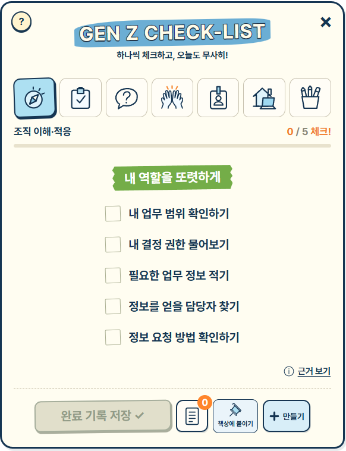 | 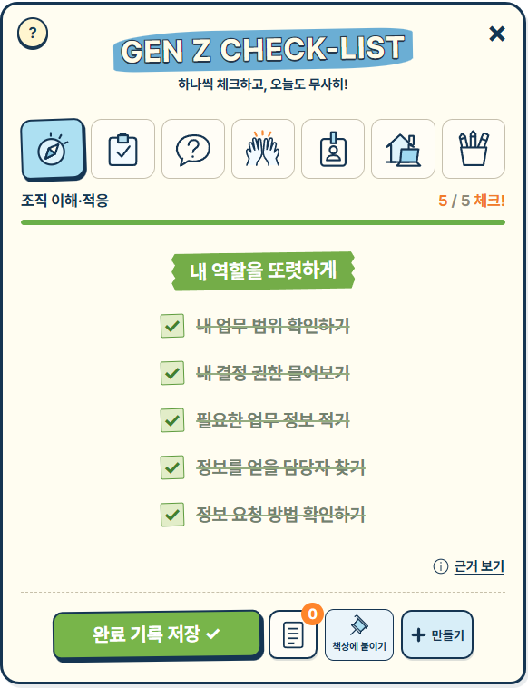 |

| 근거 보기 | 📌 책상에 붙이기 (메인 화면 메모) |
| :---: | :---: |
| 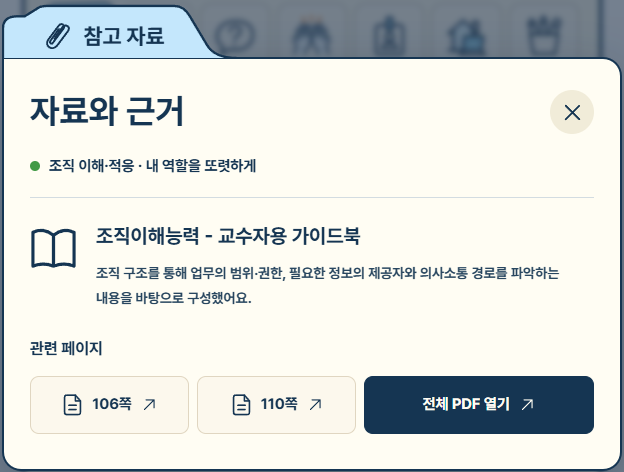 | 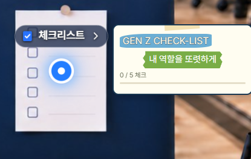 |

- Supabase `checklists` 테이블의 주제 · 항목 · 출처를 불러와 표시
- 완료 기록은 `checklist_completions`에 사용자별로 저장 (다른 사람 기록은 보이지 않도록 RLS 적용)
- **[책상에 붙이기]**: 체크리스트를 메인 사무실 화면에 메모로 고정하고, 마우스로 끌어서 원하는 위치로 이동 · 위치 기억, 메모를 누르면 진행률 미리보기 후 체크리스트로 이동

---

## 📝 2. 회사 생활, 나라면? 퀴즈 `/quiz`

카드뉴스로 배운 내용을 7개 주제별 퀴즈로 확인해요.

| 단일 · 복수 선택 | 정답일 때 | 오답일 때 |
| :---: | :---: | :---: |
| 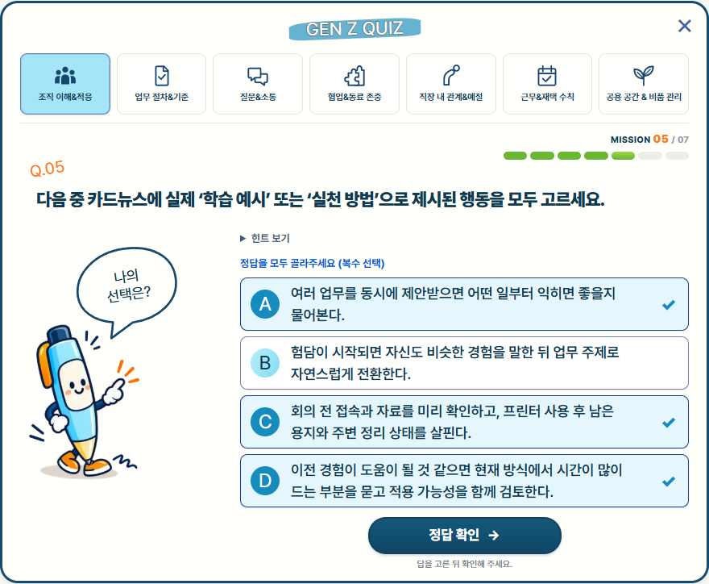 | 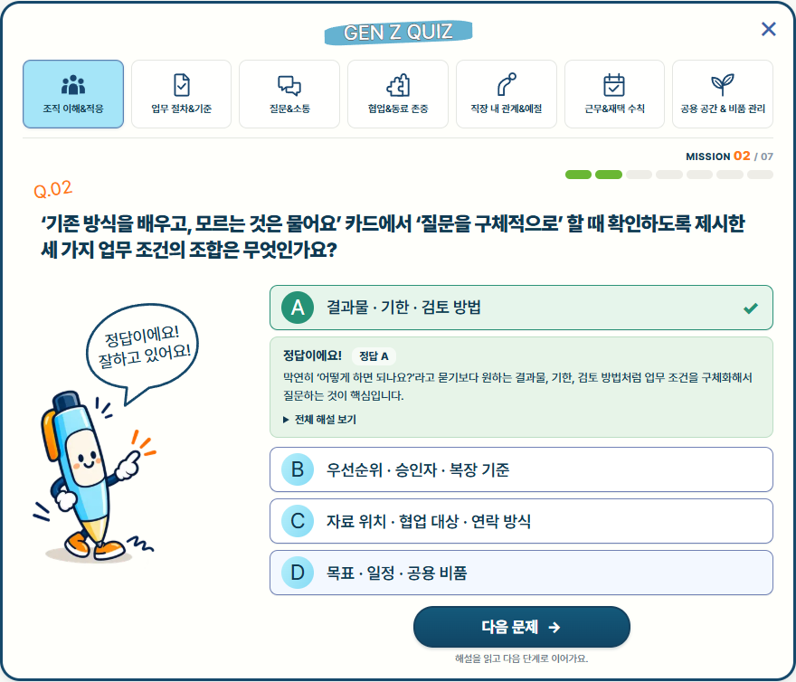 | 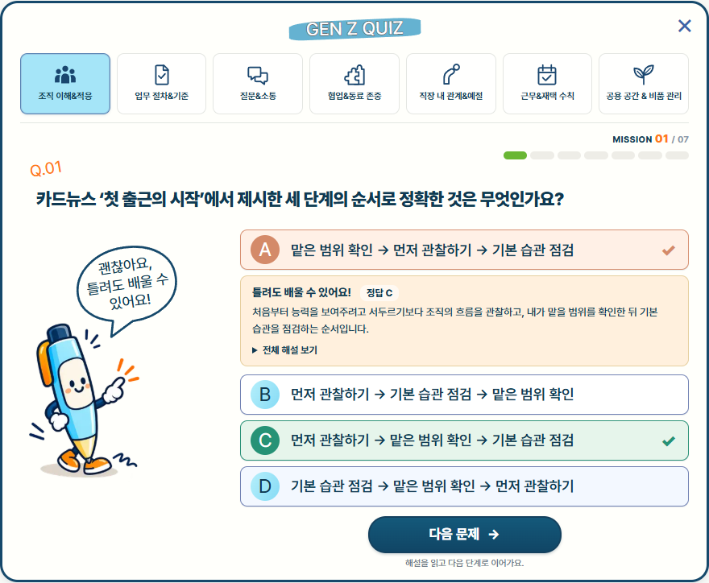 |

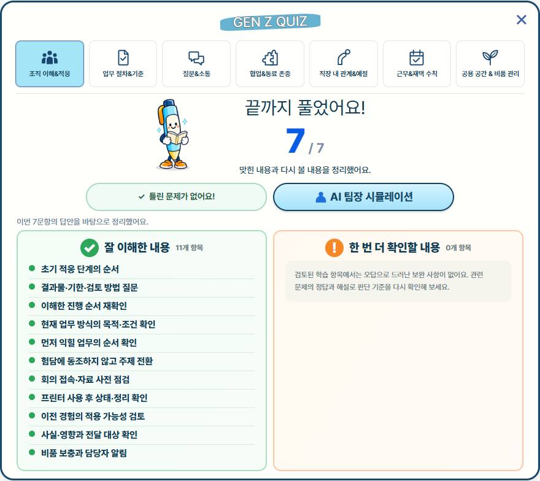

- Supabase에 업로드한 문제 · 선택지 · 정답 · 해설을 그대로 사용
- 확인 버튼을 눌러야 채점 (고르기 전에 정답을 암시하지 않음)
- 결과 화면에서 **잘 이해한 내용 / 한 번 더 확인할 내용**을 정리하고, 틀린 문제만 다시 풀기
- 결과 화면의 **AI 팀장 시뮬레이션** 버튼으로 실전 대화 연습에 연결 (팀 공동 AI 기능)

<br clear="right">

---

## 📅 3. 취업규칙 스티커 캘린더 `/calendar`

탁상달력에 붙은 스티커를 눌러 근로시간 · 휴일휴가 · 퇴직해고 규정을 배우고 OX 퀴즈로 확인해요.

| 주제별 달력 | 스티커 클릭 → 규정 안내 | OX 퀴즈 · 해설 |
| :---: | :---: | :---: |
| 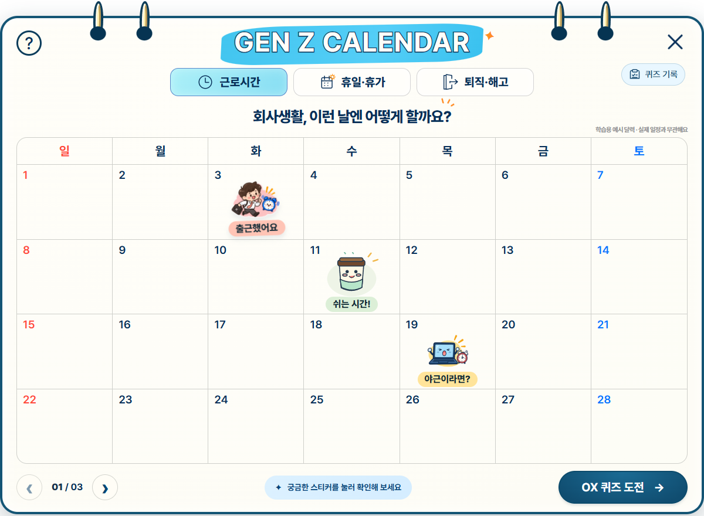 | 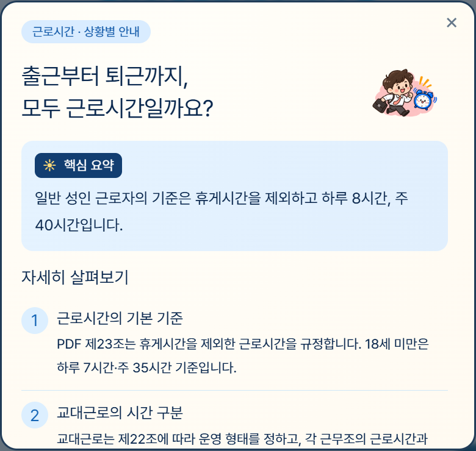 | 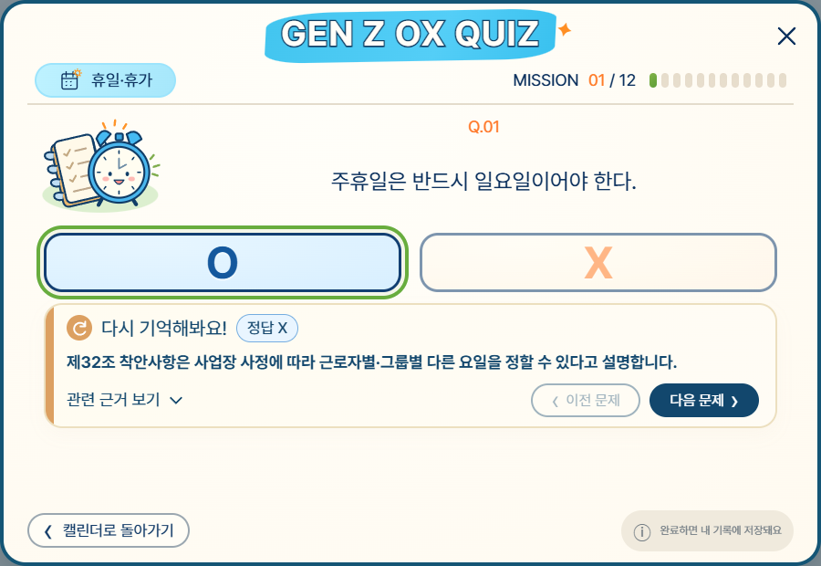 |

- 고용노동부 표준취업규칙 PDF의 조항을 근거로 상황별 안내 구성
- 탭을 바꾸면 달력 장이 넘어가는 효과, 스티커에 마우스를 올리면 튀어 오르는 효과
- OX 퀴즈 답안은 **DB 함수(`submit_calendar_quiz`)가 서버에서 채점**해서 저장 → 점수를 조작할 수 없음

---

## 🗄️ 4. Supabase 데이터 & 백엔드

### 테이블

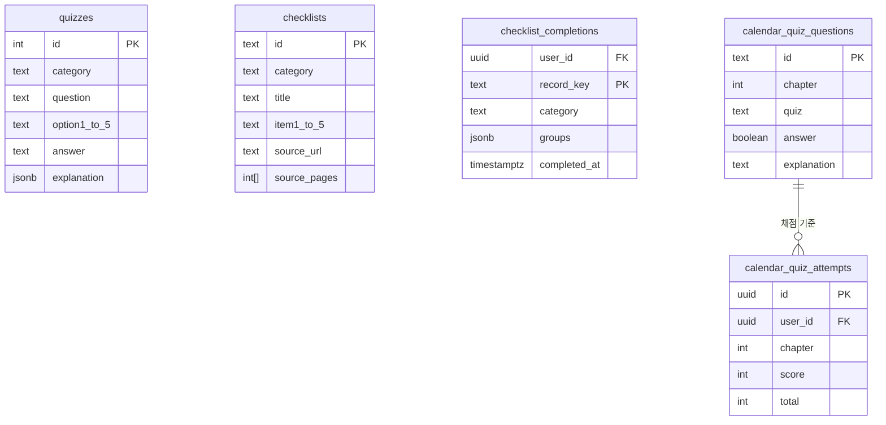

| 테이블 | 용도 |
| --- | --- |
| `quizzes` | 퀴즈 문제 · 선택지 · 정답 · 힌트 · 해설 |
| `checklists` | 체크리스트 주제 · 항목 · 근거 PDF 주소와 페이지 |
| `checklist_completions` | 사용자별 체크리스트 완료 기록 |
| `calendar_quiz_questions` / `calendar_quiz_attempts` | 달력 OX 문항 / 사용자별 풀이 결과 |

### API

| 메서드 | 주소 | 설명 |
| --- | --- | --- |
| GET | `/api/quizzes` | 퀴즈 문제 목록 |
| GET | `/api/checklists` | 체크리스트 항목과 근거 자료 |
| GET | `/api/checklist-topics` | 체크리스트 주제 7개 |

<details>
<summary>API 응답 예시 (JSON)</summary>

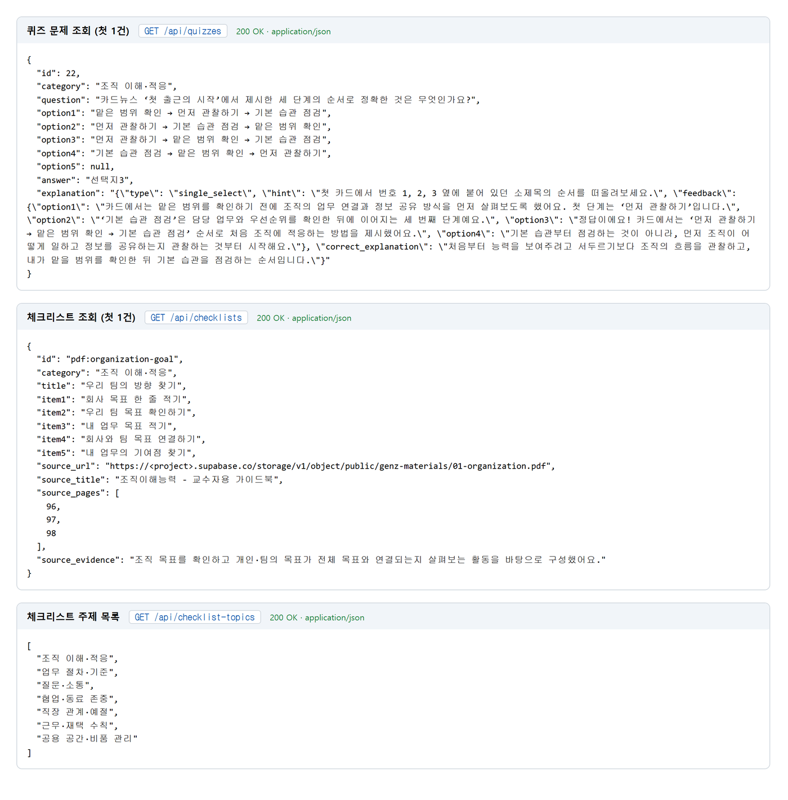

</details>

### 보안 · 데이터 처리

- **익명 로그인**으로 회원가입 없이도 사용자별 기록 저장
- **RLS(Row Level Security)**: 내 기록만 조회 · 저장 가능
- 퀴즈 점수는 브라우저가 아닌 **DB 함수에서 채점**
- API 키 등 민감 정보는 `.env.local`로 분리해 Git에 올리지 않음

---

## 💡 핵심 코드

### ① Supabase에서 체크리스트 불러오기 — `src/app/api/checklists/route.ts`

```ts
export async function GET() {
  const [saved, materials] = await Promise.all([
    supabase
      .from('checklists')
      .select('id,category,title,item1,item2,item3,item4,item5,description,source_url')
      .eq('status', '완료')                       // 검수 완료된 항목만
      .order('id', { ascending: true }),
    supabase.from('contents').select('title,category,url').order('id'),
  ]);
  if (saved.error || materials.error) {
    return NextResponse.json({ error: '체크리스트를 불러오지 못했어요. 잠시 후 다시 시도해 주세요.' }, { status: 502 });
  }
  // 저장된 미션 + 근거 PDF 기반 활동을 합쳐서 JSON으로 응답
  const pdfRows = linkedPdfRows(materials.data ?? [], process.env.NEXT_PUBLIC_SUPABASE_URL!);
  return NextResponse.json([...(saved.data ?? []), ...pdfRows]);
}
```

> Supabase에 올린 데이터 중 **검수가 끝난 항목만** 골라 화면에 보내고, 연결에 실패하면 사용자에게 안내 문구를 돌려줘요.

### ② 내 기록만 보이게 하는 RLS 정책 — `supabase/migrations/202610150001_checklist_completions.sql`

```sql
alter table public.checklist_completions enable row level security;

create policy "Read own completions" on public.checklist_completions
  for select to authenticated using ((select auth.uid()) = user_id);
create policy "Insert own completions" on public.checklist_completions
  for insert to authenticated with check ((select auth.uid()) = user_id);
```

> 로그인한 사용자 ID(`auth.uid()`)와 기록의 `user_id`가 같을 때만 조회 · 저장할 수 있어서, **다른 사람의 체크 기록은 볼 수도 고칠 수도 없어요.**

### ③ 책상 메모 드래그 — `public/intro/js/desk-notes.js`

```js
summary.addEventListener('pointerdown', event => {
  const bounds = card.getBoundingClientRect();
  pointer = { id: event.pointerId, x: event.clientX, y: event.clientY,
              left: bounds.left, top: bounds.top, moved: false };
  summary.setPointerCapture(event.pointerId);
});
summary.addEventListener('pointermove', event => {
  if (!pointer || pointer.id !== event.pointerId) return;
  const dx = event.clientX - pointer.x, dy = event.clientY - pointer.y;
  if (!pointer.moved && Math.hypot(dx, dy) < 5) return;   // 5px 미만은 클릭으로 처리
  pointer.moved = true;
  moveCard(card, pointer.left + dx, pointer.top + dy);
});
// 손을 떼면 위치 저장 → 다음 방문 때도 같은 자리에 표시
```

> 마우스 · 터치 모두 쓸 수 있는 Pointer 이벤트로 메모를 끌어 옮기고, **조금만 움직였을 때는 클릭으로 구분**해서 메모 열기와 드래그가 헷갈리지 않게 했어요. 키보드 방향키로도 옮길 수 있어요.

---

## 🤖 5. AI 활용 — 디자인 제작

퀴즈 · 체크리스트 · 캘린더 디자인을 **이미지 생성 AI**로 만들었어요. 원하는 결과가 나오도록 프롬프트를 *비주얼 특징 / 화면 구성 / 조건*으로 나눠 설계했어요.

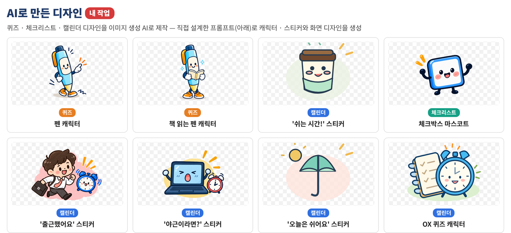

<details>
<summary>📝 퀴즈 디자인 프롬프트</summary>

- **비주얼 특징**: 남색 몸체와 금색 장식의 볼펜 캐릭터, 흰 장갑, 파란 체크 팻말, 성인 직장인에게 어울리는 친근한 2D 일러스트
- **화면 구성**: ‘회사 생활, 나라면?’ 제목, 숫자를 뺀 7개 주제 탭, 왼쪽 직장 동료의 대화 장면, 오른쪽 질문과 A~E 선택지, ‘Q1 / 3’ 진행 표시
- **조건**: 질문은 짧은 상황극 말투로 표현, Supabase의 선택지·정답·해설 유지, 답을 고르기 전 정답을 암시하지 않기, ‘내 선택 확인하기’ 버튼, 남색·크림색·파란색 중심의 읽기 쉬운 화면

</details>

<details>
<summary>📝 체크리스트 디자인 프롬프트</summary>

- **비주얼 특징**: 노란 격자 배경, 따뜻한 아이보리 종이 메모, 남색 글씨와 손그림 테두리, 초록색 테이프와 버튼, 하늘색 선택 표시
- **화면 구성**: ‘GEN Z CHECK-LIST’ 제목, 한 줄로 배치한 7개 아이콘 목차, 선택한 목차 이름과 진행률, 짧은 실천 미션 5개, ‘근거 보기’, ‘완료 기록 저장’ 버튼과 기록 아이콘
- **조건**: 스크롤 없이 한 화면에 표시, 목차 아이콘은 이모지 대신 통일된 손그림 스타일, 큰 장식은 줄이고 글씨는 선명하게, 체크한 항목은 체크 표시와 취소선으로 구분

</details>

<details>
<summary>📝 캘린더 디자인 프롬프트</summary>

- **비주얼 특징**: 상단 스프링과 남색 받침이 있는 탁상달력, 날짜 칸에 붙인 스티커, 하품하는 노트북 캐릭터와 알람시계
- **화면 구성**: ‘근로시간 / 휴일·휴가 / 퇴직·해고’ 탭, ‘출근했어요’, ‘쉬는 시간!’, ‘야근이라면?’ 스티커, 클릭 시 상황 질문·핵심 설명·자세한 규정 안내 팝업
- **조건**: 큰 제목 없이 달력 중심으로 구성, 스티커에 마우스를 올리면 살짝 튀어 오르는 효과, 탭 변경 시 달력 장 넘김 효과, 첨부 PDF 기반 OX 퀴즈와 해설, 학습용 예시 날짜 표시, 모바일에서도 사용 가능한 화면

</details>

---

## 📁 내 담당 파일 구조

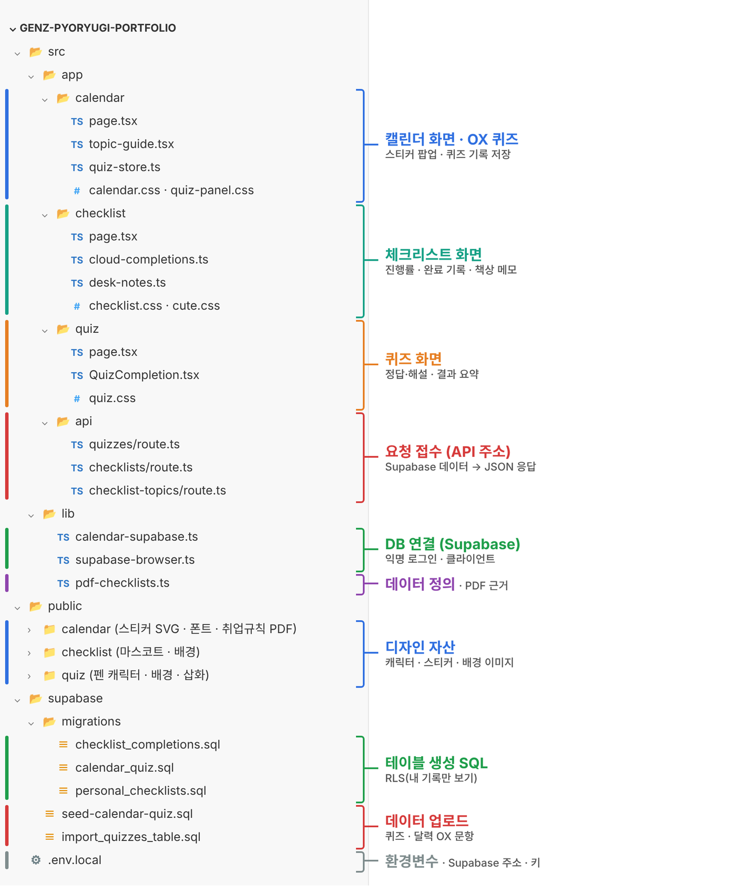

```
src/app/calendar/      캘린더 화면 · OX 퀴즈
src/app/checklist/     체크리스트 화면 · 완료 기록 · 책상 메모
src/app/quiz/          퀴즈 화면 · 결과 요약
src/app/api/           quizzes · checklists · checklist-topics API
src/lib/               Supabase 연결 · PDF 근거 데이터
public/calendar|checklist|quiz/   AI로 만든 캐릭터 · 스티커
supabase/              테이블 생성 SQL · 데이터 업로드 SQL
```

---

## ▶️ 실행 방법

```bash
npm install
npm run dev
```

`.env.local`에 Supabase 주소와 키를 넣은 뒤 `http://localhost:3000` 접속

```dotenv
NEXT_PUBLIC_SUPABASE_URL=...
NEXT_PUBLIC_SUPABASE_PUBLISHABLE_KEY=...
```

| 화면 | 주소 |
| --- | --- |
| 체크리스트 | `/checklist` |
| 퀴즈 | `/quiz` |
| 캘린더 | `/calendar` |

**🏝️ 오늘도 무사히 퇴근!**

<sub>Made with 💙 by 젠지 표류기 팀 · 동아일보 부트캠프 2026</sub>
